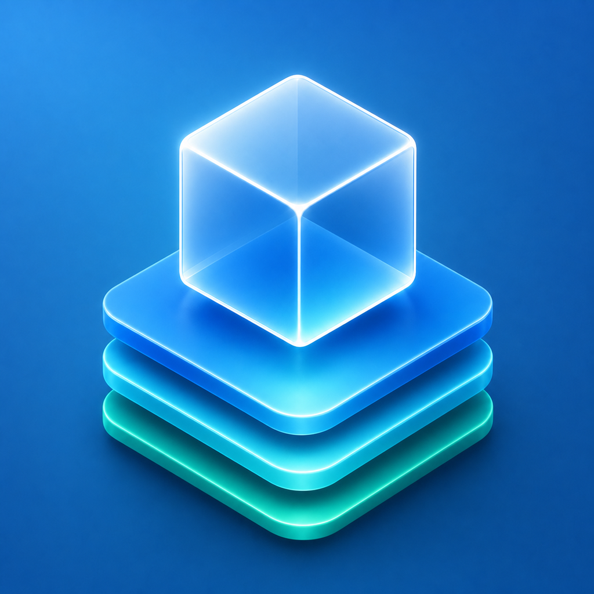

<p align="center">
  
</p>

# RunHaven


[](LICENSE)

> [!CAUTION]
> **Pre-release candidate: `v0.7.0`.** This source tree is being prepared for
> limited coworker testing, not public distribution. The desktop app must still
> be signed, notarized, and clean-Mac tested before it is shared. Container and image
> layouts, run-record formats, provider allowlists, auth-broker behavior,
> desktop behavior, and `--json` outputs may still change before a stable
> release.

RunHaven is a Rust CLI with a Tauri/React desktop app for running
Claude Code, Codex, Antigravity, Copilot, or custom coding agents inside Apple
`container` on macOS 26+ (Apple
silicon only). It does not replace those tools. It gives them a repeatable local
boundary so the secure way to run an agent is also the easy way.

It is built for people who sign in to their coding agent with a subscription or
OAuth account (Claude Pro/Max, ChatGPT, a Google account, GitHub), not only with
API keys. Signing in is one command and is reused across runs, and your host
login is never read or mounted.

## Current Surfaces

| Surface | Status | Use it for |
| --- | --- | --- |
| CLI | `v0.7.0` candidate; the `v0.5.0` command contract remains complete | Automation, explicit commands, recovery, diagnostics, and the stable backend for every UI. |
| Terminal UI | Archived, not shipped | Source is parked outside the release workspace until this surface is explicitly reopened and re-audited. |
| Desktop app | `v0.7.0` coworker-test candidate, primary easy path | Guided setup and recovery, in-app sign-in, secure launch, filtered run history, bounded logs and input, run control, worktree review, image repair, cleanup, and System Check. See the [desktop app guide](docs/DESKTOP_APP.md). |

## Why RunHaven

AI coding agents can inspect a project, edit files, run commands, and iterate
fast. That same power is risky when the agent runs directly on your Mac with
ambient access to your home directory, shell environment, SSH keys, cloud
credentials, browser profiles, and unrelated repositories. RunHaven puts each
run inside a bounded sandbox.

| Risk or need | RunHaven answer |
| --- | --- |
| Broad host access | Mounts one selected workspace at `/workspace`, not your whole home directory or credential folders. |
| Ambient credentials | Does not mount raw SSH keys, browser profiles, cloud credential folders, provider login caches, or arbitrary environment variables by default. |
| Unclear execution | `runhaven plan` prints the workspace, state volume, network mode, egress status, preflight, and Apple `container run` command before execution. |
| Repeated sign-in | The desktop app and `runhaven login <agent>` run each provider's native OAuth inside its isolated container. Later runs reuse that agent volume. RunHaven does not read Mac Keychain items, provider files from your home folder, or browser profiles. |
| Network sprawl | Uses a secure profile-aware default: provider allowlist where the agent's hosts are bundled, otherwise internet. Local-only `internal` and explicit `--network` overrides remain available. |
| Risky edits | `--worktree` runs in a RunHaven-owned git worktree you can diff, keep, recover, merge, or discard. |
| Local cleanup | RunHaven-owned images, volumes, networks, runs, egress logs, and auth-broker state have explicit inspection and cleanup commands. |

RunHaven is not a complete data-loss or exfiltration solution. The selected
agent can still read the mounted workspace and its isolated home volume, and
`internet` mode is not domain-restricted. See the
[security model](docs/SECURITY_MODEL.md) for the full boundary.

## Quick start

For coworker testing, open the signed and notarized
`RunHaven-0.7.0-macos-arm64.dmg`, drag RunHaven to Applications, eject the disk
image, and open RunHaven from Applications. The app guides the rest:

1. Download Apple's signed `container` 1.1.0 installer if it is missing.
2. Start the local container service.
3. Open Agents, install one agent, and sign in.
4. Choose New run, select a project, review access, and start.

No Rust, Git, Xcode, or Terminal is needed for that path. See
[Installation](docs/INSTALLATION.md) for the exact first-run, update, removal,
and troubleshooting steps.

Contributors can instead start Apple `container` and install from this checkout:

```bash
container system start
cargo install --path crates/runhaven --locked
```

Run the non-mutating setup guide:

```bash
runhaven setup
```

Build an agent image and sign in once:

```bash
runhaven image build claude
runhaven login claude
```

From the project directory you want the agent to work on, inspect the plan and
run:

```bash
runhaven plan claude
runhaven run claude
```

Running `runhaven` without a subcommand prints CLI help. The archived terminal
UI is not linked into release binaries.

Use the smallest project directory the agent needs. RunHaven mounts that
directory at `/workspace`, not your whole home directory. See
[Installation](docs/INSTALLATION.md) for requirements and
[Usage](docs/USAGE.md) for command-level workflows.

## Signing in

RunHaven never reads your host login state. You sign in once inside the agent
container, the credential lives in its isolated home volume, and every later
run reuses it.

| Agent | Sign in with | How it works |
| --- | --- | --- |
| Claude | `runhaven login claude` | Runs `claude auth login` inside the sandbox. Open the printed URL, approve, then paste the returned code into the terminal. |
| Codex | `runhaven login codex` | `codex login --device-auth` inside the sandbox. Enable device-code login in ChatGPT under Settings then Security. |
| Copilot | `runhaven login copilot` | The GitHub device flow inside the sandbox. Answer `y` when it offers to store the token; the file lands in the isolated volume, not on your Mac. |
| Antigravity | `runhaven login antigravity` | Starts `agy`; approve the Google sign-in in your browser, then type `/exit`. |

Each login persists in a per-agent home volume reused across projects
(`--auth-scope agent`, the default), or pass `--auth-scope project` to keep it
to one workspace. Clear a login with `runhaven login <agent> --clear`.

Prefer API keys? A host-side broker keeps the real key on the host and gives the
guest only a placeholder plus a base-URL redirect
(`runhaven run codex --api-key-broker-env OPENAI_API_KEY`). See the
[auth broker](docs/AUTH_BROKER.md) doc.

## Network and egress

RunHaven has three network modes:

| Mode | Use it for | Behavior |
| --- | --- | --- |
| `provider` | Normal hosted-agent use when provider hosts are bundled. | Managed internal network plus a host-side allowlist proxy for the agent's provider hosts. |
| `internal` | Local-only analysis or tests. | Host-only Apple `container` network with no internet egress. |
| `internet` | Package managers, registries, CDNs, or custom images that need broad internet. | Unrestricted outbound access. |

When you omit `--network`, RunHaven chooses `provider` for profiles with bundled
provider hosts and `internet` for profiles without them. In provider mode, each
agent ships a small maintained allowlist, including narrow domain-family
patterns where needed. If something is blocked, RunHaven says so in plain
language and the per-host detail is in `runhaven egress log`.

## Review and recovery

RunHaven records bounded run metadata without prompts, tokens, environment
values, or file contents, and gives every owned resource an explicit review or
cleanup path:

```bash
runhaven runs active
runhaven runs status <run-id>
runhaven runs logs-follow <run-id>
runhaven runs stop <run-id>
runhaven runs kill <run-id>
runhaven runs repair <run-id>
runhaven runs list
runhaven runs show <run-id>
runhaven runs log <run-id>
runhaven runs diff <run-id>
runhaven runs merge <run-id>
runhaven runs discard <run-id>
runhaven state list
runhaven network list
runhaven image doctor
```

The terminal checkpoint exposes active-run summaries, typed stop/hard-stop/repair
controls, bounded log snapshots only after you type `logs`, run history without
host workspace paths, run diff review only after you type `diff`, preflight
checks, secret-free diagnostics, and post-run recovery over the same validated
cores. The desktop app includes worktree review, image repair, and stale-network
cleanup. Resetting or pruning saved agent state remains CLI-only because it can
erase a saved sign-in.

## Status and roadmap

RunHaven is alpha/pre-release. `v0.5.0` was the CLI-only release; `v0.7.0` is
the current CLI plus desktop coworker-test candidate.
This checkout keeps the Codex-derived TUI source as an archived reference, but
it is outside the release workspace and binaries. The Tauri/React desktop shell is
alpha and is now the primary easy path: it covers guided setup recovery,
sign-in, reviewed launch, filtered run history, sanitized live status, bounded
output and input, stop, hard stop, repair, worktree review, image repair,
network cleanup, and secret-free System Check. Saved-state reset remains
CLI-only.

The roadmap now treats the CLI as the complete technical surface, the archived
TUI as future work requiring a fresh audit, and the desktop app as the easiest path
(full detail in [ROADMAP.md](docs/ROADMAP.md) and the
[release plan](docs/V1_RELEASE_PLAN.md)):

- **`v0.5.0`, CLI complete:** the command set, docs, JSON and local-data
  decisions, runtime smokes, profile support tiers, diagnostics, cleanup, and
  security boundaries are finished and verified for the CLI-only pre-release.
- **Runtime and security hardening:** completed slices are recorded in the
  roadmap and state files; keep runtime evidence current when the boundary is
  touched.
- **Archived terminal UI:** its source remains for future work, but it is not a
  workspace member or release dependency and `runhaven` does not launch it.
- **Remaining non-UI scope and CLI public release:** promote one design-first
  item at a time without weakening CLI semantics or default safety.
- **`v0.7.0` coworker-test candidate:** the native macOS app is the easiest
  safe path for nontechnical users. A shareable artifact still needs signing,
  notarization, and clean-Mac verification.

## Product rule

The secure path must be the easy path: secure defaults are the shortest
workflow, supported lower-security choices warn and require explicit intent, and
unsupported, invalid, or hard-boundary violations fail closed. Apple
`container machine` is not the default boundary; explicit or user-managed machine
workflows are warned, not blocked solely for being less secure.

## Documentation

Use the smallest doc that matches the question:

| Need | Start here |
| --- | --- |
| Install and run | [Installation](docs/INSTALLATION.md), [Capabilities](docs/CAPABILITIES.md), [Usage](docs/USAGE.md) |
| Sign-in and credentials | [Auth broker](docs/AUTH_BROKER.md), [Provider endpoints](docs/PROVIDER_ENDPOINTS.md) |
| Security and runtime boundary | [Security model](docs/SECURITY_MODEL.md), [Apple Container gap analysis](docs/APPLE_CONTAINER_GAP_ANALYSIS.md) |
| Architecture and research | [Architecture](docs/ARCHITECTURE.md), [Research](docs/RESEARCH.md) |
| Terminal UI | [TUI build plan](docs/plans/tui-build-plan.md), [TUI architecture](docs/plans/tui-architecture.md), [TUI brand graphics](docs/plans/ratatui-brand-graphics.md) |
| Desktop UI | [Desktop app guide](docs/DESKTOP_APP.md), [Tauri UI guardrails](docs/TAURI_UI_GUARDRAILS.md), [Tauri log viewing design](docs/TAURI_LOG_VIEWING_DESIGN.md), [Tauri UI research plan](docs/TAURI_UI_RESEARCH_PLAN.md) |
| Release planning | [Roadmap](docs/ROADMAP.md), [v0.5.0 release plan](docs/V1_RELEASE_PLAN.md), [Release gap analysis](docs/RELEASE_GAP_ANALYSIS.md), [CLI surface coverage](docs/CLI_SURFACE_COVERAGE.md), [Pinning policy](docs/PINNING.md) |
| Project operations | [Harness](docs/harness/README.md), [Contributing](CONTRIBUTING.md), [Security policy](SECURITY.md) |

## Development

Agent-assisted work starts from three files only: [AGENTS.md](AGENTS.md),
[feature_list.json](feature_list.json), and
[current-state.md](current-state.md). Load the harness docs only when a task
touches that surface.

Use the smallest relevant check for a change:

```bash
cargo fmt --check
cargo test --locked
cargo clippy --all-targets -- -D warnings
cargo run --locked --bin runhaven-check-pins
npm --prefix ui run check
npm --prefix ui test
npm --prefix ui run test:e2e
git diff --check
```

Full local harness verification is `./init.sh`. Opt-in Apple `container` runtime
smokes are `scripts/apple_container_smoke.sh` (add `--with-provider` for the
egress checks). Docs-only changes use the docs checks from
[the verification matrix](docs/harness/feedback/verification-matrix.md); runtime,
security-boundary, image, or install-flow changes need focused tests plus the
relevant Apple `container` smokes.

## License

[MIT](LICENSE)
